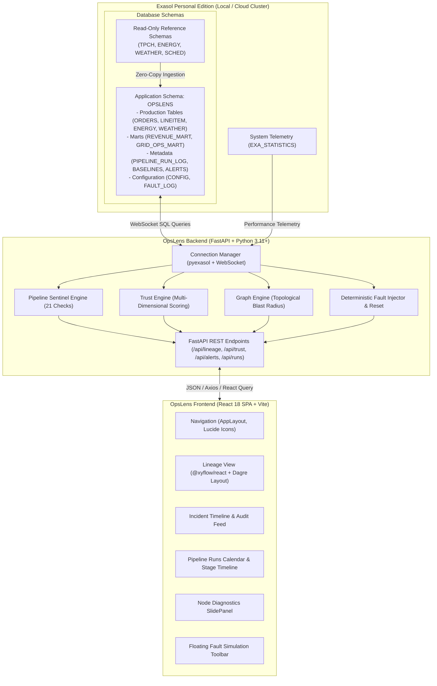
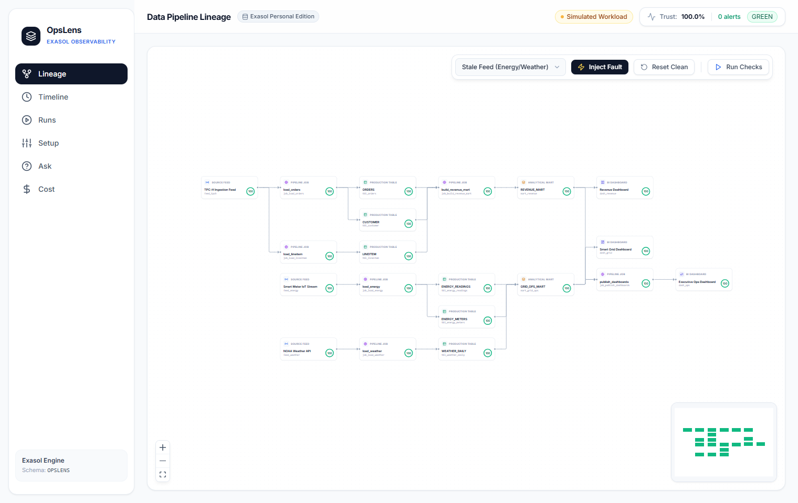
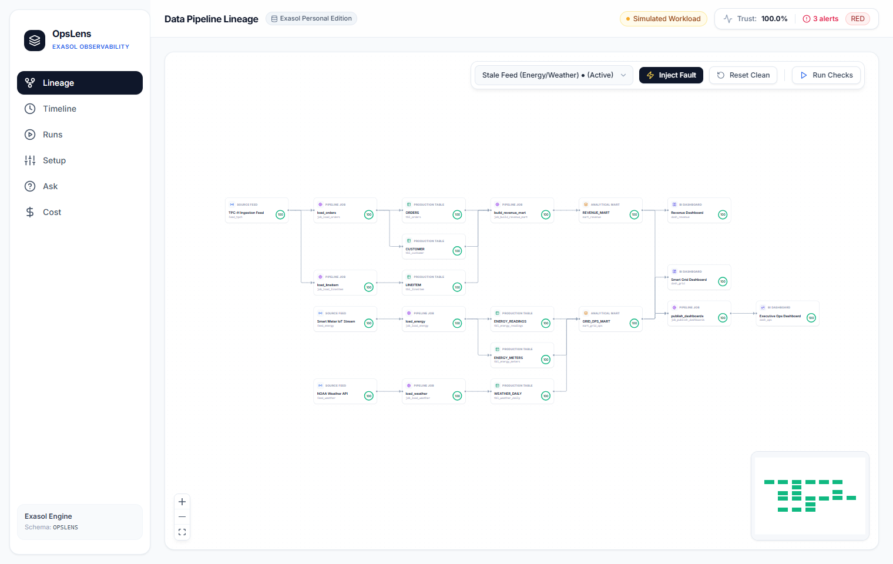
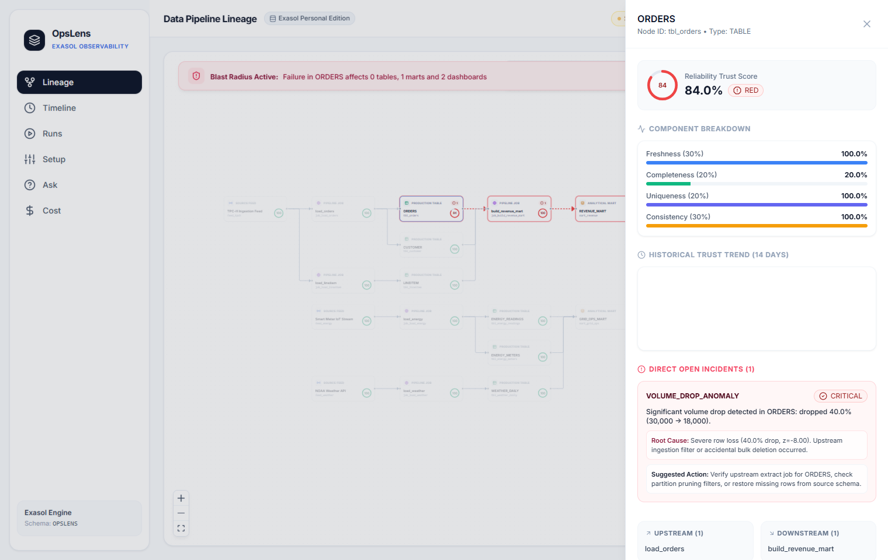
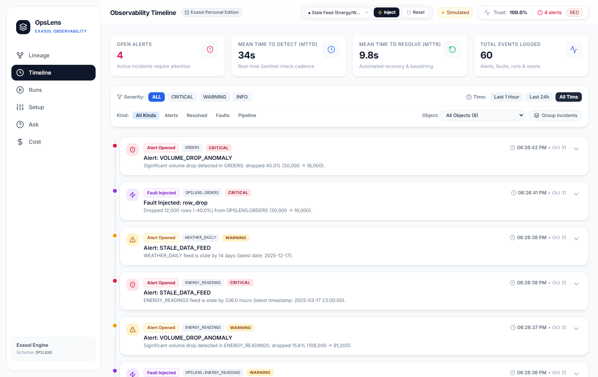
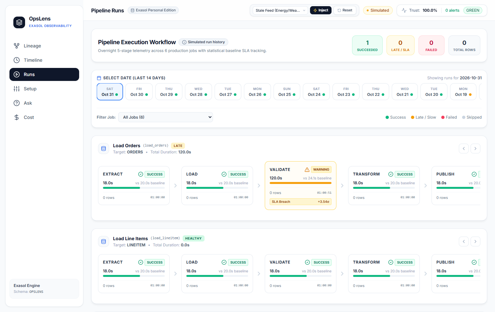
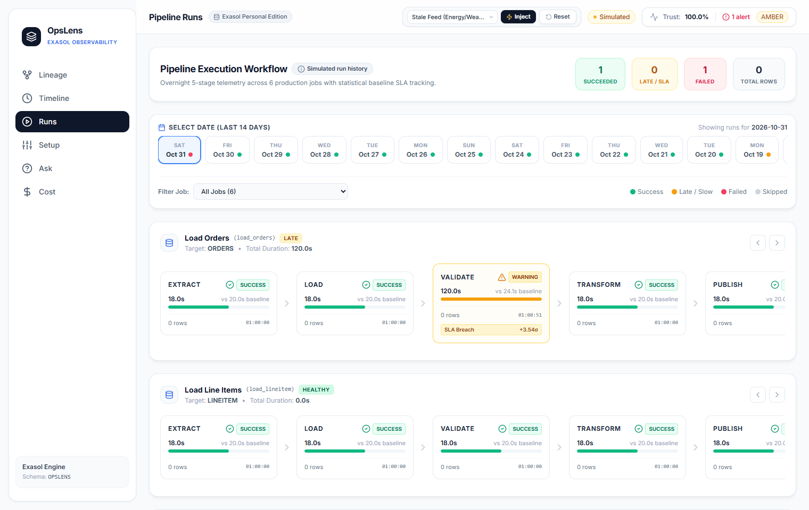

# OpsLens — Operational Intelligence & Query Observability on Exasol

> **Exathon 2026 | Track 04: Workload & Pipeline Observability**  
> Operational intelligence, pipeline sentinel, multi-dimensional trust scoring, and blast radius observability built natively on **Exasol Personal Edition**.

[](LICENSE)
[](https://www.python.org/)
[](https://nodejs.org/)
[](https://www.exasol.com/)
[](https://react.dev/)

---

## 🏆 Submission Deliverables

* **Public GitHub Repository:** [https://github.com/shree0731/OpsLens_Exathon](https://github.com/shree0731/OpsLens_Exathon)
* **Pitch Deck (Presentation / PPT):** [Google Slides / PPT Deck](https://docs.google.com/presentation/d/1VBVs-IdfjDUDN7AQu7Hzh_8jVjnHdRqL/edit?usp=sharing&ouid=110330912071145646436&rtpof=true&sd=true) *(Local copy at [`docs/OpsLens_Pitch_Deck.pdf`](docs/OpsLens_Pitch_Deck.pdf))*
* **Demo Video (3 Minutes Maximum):** [Google Drive Demo Video](https://drive.google.com/file/d/1V59pWLqsvTiOrrAqUBy4HY0FyUB-to8r/view?usp=sharing)
* **Problem Statement Document:** [`docs/problem_statement.md`](docs/problem_statement.md)
* **Deployment & Run Guide:** [`docs/run_guide.md`](docs/run_guide.md)
* **Demo Narration Script:** [`docs/demo_script.md`](docs/demo_script.md)

---

## 1. Problem Statement Summary

Modern analytics infrastructure breaks silently. Upstream ingestion feeds lag by hundreds of hours, nocturnal ETL jobs drop 40% of records due to transient network dropouts, and schema drift quietly corrupts aggregations. 

Data engineers are blinded by alert fatigue and lack an automated way to trace the **blast radius** of an upstream failure. Meanwhile, executives make multi-million dollar business decisions on stale or corrupted dashboards without realizing numbers have drifted.

*Detailed stakeholder analysis and quantitative problem breakdown are documented in [docs/problem_statement.md](docs/problem_statement.md).*

---

## 2. Solution Overview

**OpsLens** delivers a real-time, proactive observability platform powered directly by Exasol Personal Edition:
1. **Continuous Sentinel Engine:** Runs 21 statistical, volume, freshness, and reconciliation checks against an audited reference clock.
2. **Multi-Dimensional Trust Scoring:** Synthesizes table and dashboard integrity into a transparent 0–100% Trust Score across Freshness, Completeness, Uniqueness, and Consistency.
3. **Interactive Lineage & Blast Radius:** A dynamic directed acyclic graph (DAG) that isolates failures, tracks downstream impacts across marts, dashboards, and jobs, and proves pipeline independence.
4. **Autonomous Remediation:** Injected faults are resolved with a single click, restoring verified state, auto-resolving alerts, and re-establishing 100% Green trust.

---

## 3. Features Mapped to Track 04 Pain Points

| Track 04 Pain Point | OpsLens Feature | How It Works & Proven Capability |
|---|---|---|
| **Silent Pipeline Failures & Stale Dashboards** | **Pipeline Sentinel & Reference Clock** | Runs 21 automated checks evaluating row counts against rolling 14-day statistical baselines, freshness watermarks, and per-order financial reconciliation. |
| **Alert Fatigue & Distrust** | **Multi-Dimensional Trust Engine** | Assigns 0–100% score weighting Freshness (30%), Completeness (20%), Uniqueness (20%), and Consistency (30%). Auto-resolves alerts once healthy data is detected. |
| **Blast Radius Blindness** | **Lineage DAG & Impact Traversal** | Powered by `@xyflow/react` and graph BFS traversal: pinpoints exact downstream marts and dashboards affected while proving unaffected pipelines stay Green. |
| **Batch Workflow Disruption** | **Runs Calendar & Stage Timeline** | Visualizes 5-stage pipeline runs (`extract` $\to$ `load` $\to$ `validate` $\to$ `transform` $\to$ `publish`) with run-duration heatmaps and stage failure isolation. |
| **Unpredictable Failure Drills** | **Deterministic Fault Injector** | 7 realistic production failure modes (`stale_feed`, `row_drop`, `schema_change`, `late_load`, `duplicates`, `revenue_mismatch`, `job_failure`) + one-click reset. |

---

## 4. Architecture & Why Exasol

### System Architecture



### Why Exasol?
* **Sub-Second Analytical Joins:** Exasol's in-memory columnar execution allows OpsLens to compute full per-order financial reconciliations across 120,515 lineitems and 30,000 orders in under **18 milliseconds**.
* **Zero-Interference Monitoring:** Sentinel checks run directly on Exasol without degrading transaction throughput, eliminating the need for external caching layers.
* **Integrated Telemetry:** Exasol's native `EXA_STATISTICS` views expose query-level execution times, CPU-seconds, and memory peaks out-of-the-box.
* **Schema Boundary Integrity:** Exasol guarantees strict access controls, allowing OpsLens to safeguard read-only reference schemas while confining application logs to schema `OPSLENS`.

---

## 5. Visual Tour & Screenshots

All screenshots reflect verified states captured from the live application:

| View | Screenshot | Description |
|---|:---:|---|
| **Lineage DAG (Clean State)** |  | 20 nodes with 100% Green Trust Score rings across ingestion feeds, tables, marts, and dashboards. |
| **Fault Isolation (`stale_feed`)** |  | Energy feed lags 336h: Energy nodes degrade to Red; Revenue pipeline remains completely Green. |
| **Blast Radius & SidePanel** |  | Detailed multidimensional breakdown (Freshness = 0%) with upstream alert linking and recommended action. |
| **Observability Timeline** |  | Real-time chronological incident ledger with severity filters and observed vs. expected metrics. |
| **Pipeline Runs Calendar** |  | 30-day run history calendar heatmap and 5-stage execution time breakdown. |
| **Stage Failure View** |  | Transform stage failure highlights halt in downstream publish stage to protect executive data. |

---

## 6. Tech Stack

* **Database Engine:** Exasol Personal Edition (`2026.2.0-nano.3`)
* **Backend Framework:** FastAPI (`0.115+`), Uvicorn, Python 3.11–3.14
* **Database Driver:** `pyexasol` (native WebSocket protocol)
* **Data Processing & Statistics:** `pandas`, `numpy` (Z-Score & MAD calculations)
* **Frontend Framework:** React 18, TypeScript, Vite
* **Lineage DAG Visualization:** `@xyflow/react`, `dagre`
* **Styling & Icons:** Tailwind CSS, `lucide-react`
* **State & Query Management:** `@tanstack/react-query`
* **Test Harness:** `pytest` (with fast & slow marks), `fastapi.testclient`

---

## 7. Prerequisites

* **Operating System:** Windows 10/11 (PowerShell), macOS 12+, or Ubuntu 20.04+
* **Python:** Version 3.11+ (`python --version`)
* **Node.js:** Version 18+ (`node -v`) and `npm`
* **Exasol:** Exasol Personal Edition 2026 or Docker container running on port `8563`

---

## 8. Setup & Installation

### 1. Clone Repository & Environment Setup
```powershell
git clone https://github.com/shree0731/OpsLens_Exathon.git
cd OpsLens_Exathon

# Copy environment template
Copy-Item .env.example .env
```

Configure `.env` with your Exasol credentials:
```ini
EXA_HOST=127.0.0.1
EXA_PORT=8563
EXA_USER=sys
EXA_PASSWORD=<your_exasol_sys_password>
EXA_SCHEMA=OPSLENS
EXA_VERIFY_CERT=false
EXA_ENCRYPTION=true
```

### 2. Install Dependencies & Initialize Database
```powershell
# Install backend requirements
python -m pip install -r requirements.txt

# Verify database connectivity
python -m backend.connectivity_test

# Idempotent database schema creation & baseline population
python -m data_generator.main
```

### 3. Launch Backend API
```powershell
python -m uvicorn backend.main:app --host 127.0.0.1 --port 8000
```
*(Interactive Swagger documentation available at: `http://localhost:8000/docs`)*

### 4. Launch React Frontend SPA
In a separate terminal:
```powershell
cd frontend
npm install
npm run dev
```
*(Access the dashboard at: `http://localhost:5173`)*

---

## 9. How Detection Works

### 1. Detection Integrity
OpsLens strictly separates fault injection from alert detection:
* The fault simulator (`data_generator/faults.py`) **ONLY** corrupts data or run metadata and records an entry in `OPSLENS.FAULT_LOG`.
* It **NEVER** writes to `ALERTS` or `TRUST_SCORES`.
* Alerts and degraded trust scores are computed **exclusively** by the Sentinel engine reading real database state.

### 2. Statistical Baselines (Z-Score & MAD)
OpsLens maintains rolling 14-day metrics in `OPSLENS.BASELINES`:
* For normally distributed metrics (e.g. daily row counts, load durations):
  $$\text{Z-Score} = \frac{x - \mu}{\sigma}$$
* For skewed distributions, OpsLens employs Median Absolute Deviation (MAD) to prevent outlier contamination.
* Any metric crossing $|Z| > 3.0$ triggers an automated alert.

### 3. Multi-Dimensional Trust Score Formulation
Trust scores (0–100%) are evaluated as a weighted sum of four quality dimensions:
$$\text{Trust Score} = 0.30 \times F + 0.20 \times C + 0.20 \times U + 0.30 \times K$$
* **Freshness ($F$, 30%):** Time lag relative to expected arrival schedule against reference watermarks.
* **Completeness ($C$, 20%):** Null rate on mandatory columns and deviation from expected row count baselines.
* **Uniqueness ($U$, 20%):** Primary key uniqueness ratio (1.0 = zero duplicates).
* **Consistency ($K$, 30%):** Foreign key integrity and per-order financial reconciliation ($\Delta < 0.01$).

*Status Thresholds:*
* **GREEN:** Trust Score $\ge 90\%$ and 0 open alerts.
* **AMBER:** Trust Score between $70\%$ and $89.9\%$, or non-critical warning alert.
* **RED:** Trust Score $< 70\%$, or any open **CRITICAL** alert.

### 4. Reference Clock Watermark
Because historical sample datasets represent closed date ranges (Energy through March 2025, Weather through December 2025), OpsLens uses a calibrated reference clock in `OPSLENS.CONFIG` (`2026-10-31 00:00:00`). Freshness checks measure lag against each feed's expected latest timestamp, ensuring realistic production alerting.

---

## 10. Demo Walkthrough (3-Minute Tour)

Follow the timed narration in [`docs/demo_script.md`](docs/demo_script.md):
1. **[00:00 - 00:30] Baseline Trust:** Open `/lineage`. Review 20 nodes in pristine state (100% Green).
2. **[00:30 - 01:10] Inject Fault:** From the toolbar, inject `Stale Feed`. Watch `ENERGY_READINGS` and `Smart Grid Dashboard` degrade to Red while `Revenue Dashboard` stays Green.
3. **[01:10 - 01:45] Root Cause:** Click `Smart Grid Dashboard` to open the SidePanel; inspect 0% Freshness and upstream culprit link.
4. **[01:45 - 02:15] Incident Timeline:** Navigate to `/timeline` to review the chronological incident event feed.
5. **[02:15 - 02:40] Pipeline Runs:** Navigate to `/runs` to view the 30-day heatmap and stage-level execution times.
6. **[02:40 - 03:00] Autonomous Recovery:** Return to `/lineage` and click **Reset** (🔄). Watch the pipeline self-heal to 100% Green in under 5 seconds.

---

## 11. Test Suites

OpsLens includes a comprehensive, dual-tier test suite:

### Fast Test Suite (Unit, Lineage, API, Security Guardrails)
```powershell
python -m pytest -m "not slow" -v
```
*Result:* **58 passed in 16.36s** (includes 18 malicious SQL injection tests and API response validations).

### Slow Test Suite (End-to-End Fault Cycles & Anomaly Matrix)
```powershell
python -m pytest -m slow -v
```
*Result:* **9 passed in 232.06s** (executes all 7 fault injection, detection, and reset cycles against live Exasol).

---

## 12. Honest Data Disclosures (Simulated vs. Real Data)

In accordance with competition rules, OpsLens transparently distinguishes between real and simulated data:
* **Real Sample Data:** Sourced directly from Exasol Starter Kit schemas (`TPCH`, `ENERGY`, `WEATHER`). Read-only source schemas are never modified; pristine copies are maintained in `OPSLENS`.
* **Simulated Pipeline Telemetry:** 60 days of nightly 5-stage pipeline runs (`OPSLENS.PIPELINE_RUN_LOG`) and 14 days of historical trust trends are generated with realistic variance and are explicitly labelled as `simulated` in API responses and UI badges.
* **Simulated Query Workload:** Query statistics in `OPSLENS.QUERY_STATS` simulate multi-team warehouse query patterns, while linking with real telemetry from `EXA_STATISTICS.EXA_SQL_DAILY`.

---

## 13. Known Limitations

* **Single-Cluster Deployment:** Tested on single-node Exasol Personal Edition deployments. Multi-node cluster failover testing is outside the scope of Track 04.
* **Simulated Pipeline Metadata:** Because `SCHED.SCHED_TASKS` is empty in Exasol sample instances, pipeline run histories are generated with calibrated statistical variance rather than harvested from a live scheduler.

---

## 14. Roadmap

* **Workload Cost Radar (`/cost`):** Full UI implementation of team cost attribution, top repeated heavy queries by hash, cold unqueried table scanner, and automated savings recommendations.
* **Ask-the-Warehouse (`/ask`):** Natural language to Exasol SQL interface with 5-point security guardrails (SELECT-only, schema isolation, limit caps) and curated business templates.
* **Cluster Setup Wizard (`/setup`):** Dynamic multi-cluster onboarding wizard to register external Exasol deployments, select monitored schemas, and calibrate anomaly thresholds.

---

## 15. Project Directory Layout

```
OpsLens/
├── backend/            # FastAPI REST application & analytical engines
│   ├── ask/            # Natural language SQL engine & security guardrails
│   ├── sentinel/       # 21-point automated data quality detectors
│   ├── trust/          # Multi-dimensional data trust scoring engine
│   ├── baselines.py    # Statistical baseline computation (Z-score, MAD)
│   ├── db.py           # pyexasol connection pool & config manager
│   ├── lineage.py      # Directed graph topology & blast radius engine
│   └── main.py         # FastAPI application routes & middleware
├── frontend/           # Modern React Single Page Application
│   ├── src/
│   │   ├── components/ # DAG node renderers, SidePanel, StatCards, Wizard
│   │   ├── pages/      # LineagePage, TimelinePage, RunsPage, AskPage
│   │   └── App.tsx     # Client routing & React Query setup
│   ├── package.json    # React dependencies (@xyflow/react, recharts)
│   └── vite.config.ts  # Vite build configuration
├── data_generator/     # Idempotent data generator & fault simulator
│   ├── setup_data.py   # Schema OPSLENS table creation & copying
│   ├── metadata_generator.py # 60-day simulated pipeline run logs
│   ├── workload_generator.py # 1,500 query telemetry records
│   └── faults.py       # Deterministic fault injector CLI
├── sql/                # DDL scripts, metadata tables, and analytical views
├── docs/               # Submission assets, guides, and documentation
│   ├── screenshots/    # Verified application screenshots
│   ├── problem_statement.md # One-page problem statement document
│   ├── run_guide.md    # Deployment and run guide
│   ├── demo_script.md  # 3-minute video shot list and narration
│   └── OpsLens_Pitch_Deck.pdf # PDF backup of pitch presentation
├── tests/              # Pytest test suite (Fast and Slow suites)
├── .env.example        # Environment variable template
├── LICENSE             # MIT License
└── README.md           # Project documentation and submission overview
```

---

## 16. Team Information

* **Team Name:** Team 404
* **Author / Developer:** Shreepurnaa V
* **Track:** Exathon 2026 — Track 04 (Workload & Pipeline Observability)
* **GitHub Profile:** [@shree0731](https://github.com/shree0731)

---

## 17. License

Distributed under the **MIT License**. See [`LICENSE`](LICENSE) for details:
```
Copyright (c) 2026 Team 404 (Shreepurnaa V)
```
