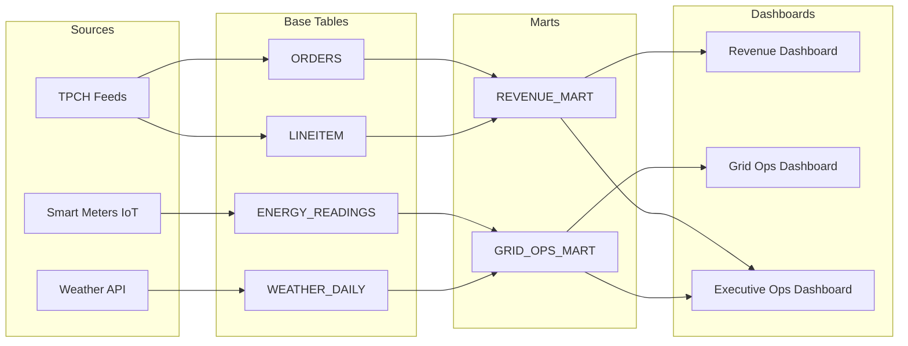

# OpsLens Multi-Dimensional Data Trust Engine

## Overview
The **OpsLens Trust Score Engine** quantifies data reliability, freshness, and structural health across Exasol tables, analytical data marts, and executive dashboards. Rather than reporting binary pass/fail states, it assigns a normalized continuous trust score from **0.0 to 100.0** with explainable sub-pillar metrics.

---

## 1. Mathematical Formulation

$$\text{Trust Score} = 0.30 \times \text{Freshness} + 0.20 \times \text{Completeness} + 0.20 \times \text{Uniqueness} + 0.30 \times \text{Consistency}$$

### Component Breakdown
| Component | Weight | Target / Metric | Failure Penalty |
| :--- | :---: | :--- | :--- |
| **Freshness** | **30%** | Telemetry lag evaluated against `OPSLENS.CONFIG` reference clock (`reference_now`) and job timeliness SLA. | Drops proportionally to lag. $\ge 7$ days stale drops Freshness to 0.0. Late-running load drops to 40.0. |
| **Completeness**| **20%** | Row volume vs 14-day rolling baseline in `OPSLENS.BASELINES`. | Drops proportionally: $\max(0, 100 - 2 \times \text{drop}\%)$. A 40% row drop produces a Completeness score of 20.0. |
| **Uniqueness**  | **20%** | Duplicate primary keys on `ORDERS (O_ORDERKEY)` and composite keys on `LINEITEM (L_ORDERKEY, L_LINENUMBER)`. | Duplicates degrade score immediately down to 15.0. |
| **Consistency** | **30%** | Per-order financial reconciliation between `ORDERS` and `LINEITEM` ($\le \$0.10$ tolerance), plus schema contract drift. | Reconciliation divergence drops consistency proportionally. Unapproved schema drift applies a -35 point penalty. |

---

## 2. Health Status Thresholds

- 🟢 **GREEN ($\ge 85.0$)**: Healthy, production-ready dataset. All pipelines within SLAs and zero discrepancies.
- 🟡 **AMBER ($60.0 - 84.9$)**: Degraded dataset. Minor freshness lag, non-fatal stage delays, or mild anomaly. Downstream consumption allowed with warning.
- 🔴 **RED ($< 60.0$)**: Severe incident. Critical data drop, broken reconciliation, duplicate keys, or stale feed breach. Automated alerts dispatched.

---

## 3. Reference Clock Architecture

To guarantee deterministic, repeatable observability independent of the physical host calendar, OpsLens maintains a dedicated system clock configuration table:

```sql
SELECT PARAM_KEY, PARAM_VALUE FROM OPSLENS.CONFIG;
```

- `reference_now`: `2025-04-01 00:00:00`
- `expected_latest_energy`: `2025-03-31 23:00:00`
- `expected_latest_weather`: `2025-12-31 00:00:00`

All freshness detectors measure lag against these expected arrival watermarks. When `stale_feed` removes the most recent 14 days of telemetry, the lag jumps to 336 hours, immediately triggering detection. Resetting restores the watermarks and data.

---

## 4. Lineage Propagation & Blast Radius

Data quality issues cascade downstream through the lineage graph defined in `OPSLENS.LINEAGE_EDGES`:



### Inheritance Rule
Dashboards and analytical marts inherit the **minimum health of their upstream dependencies**:
$$\text{Trust}(\text{Dashboard}) = \min_{t \in \text{Upstream}}(\text{Trust}(t))$$

If `ENERGY_READINGS` is corrupted by a stale feed, `GRID_OPS_MART` and `Grid Ops Dashboard` immediately reflect the degraded score, while `Executive Ops Dashboard` warns executive leadership of compromised energy figures.
